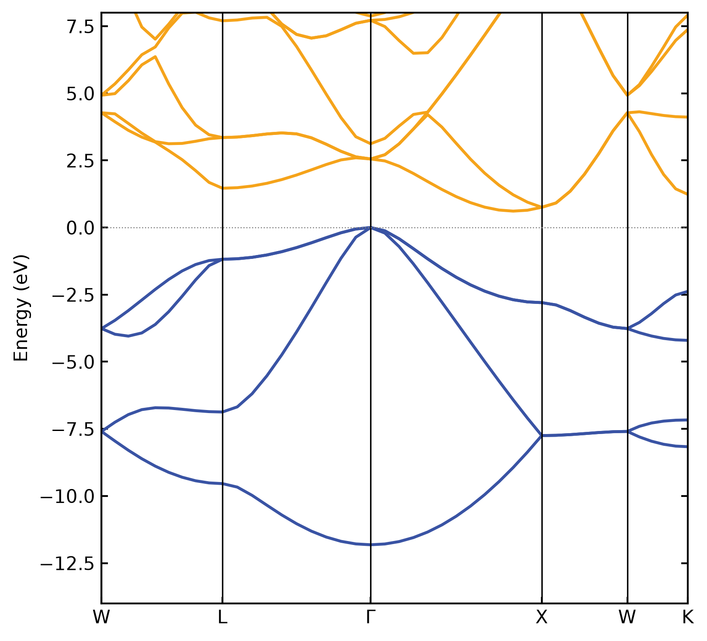
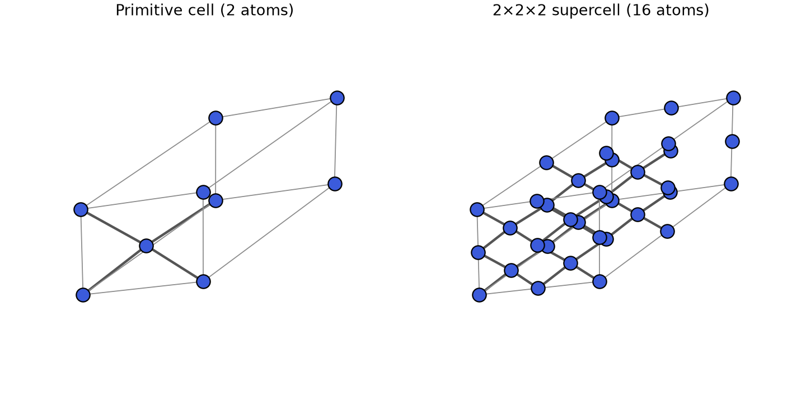
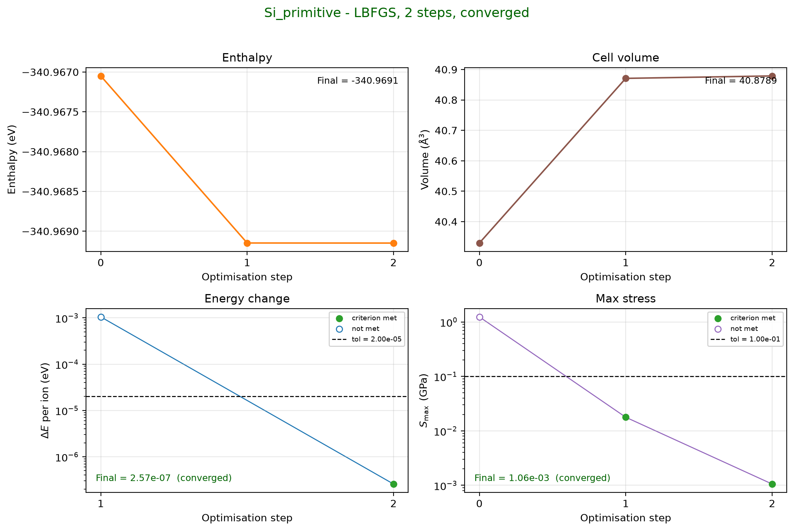
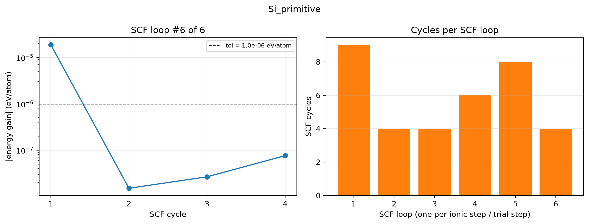
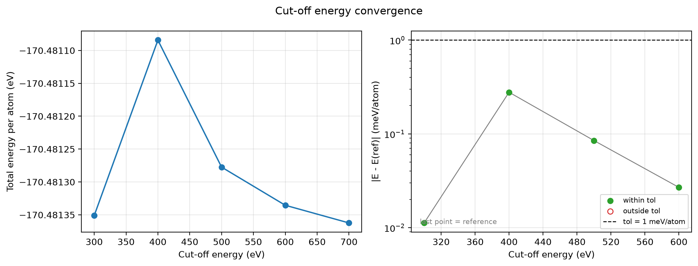
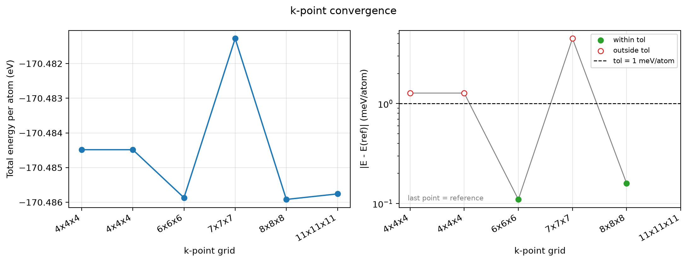
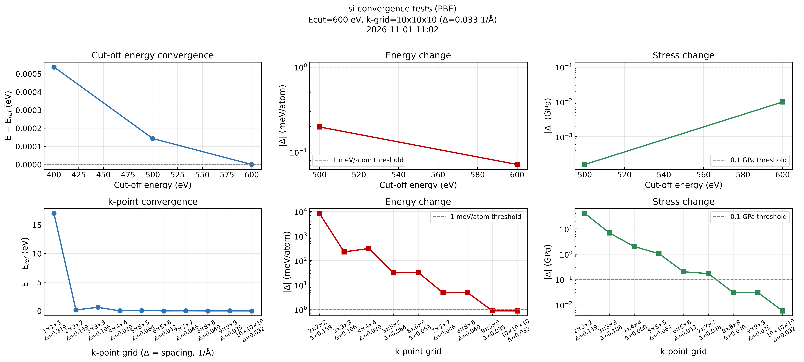

# castep-easytool

[](https://github.com/jawwadsaifpk/castep-easytool/releases)

A command-line toolkit for the whole [CASTEP](http://www.castep.org/) plane-wave DFT workflow: build and convert structures, write inputs, converge cut-off and k-points, check runs, extract optimised geometries, and plot band structures. All commands are pure Python and read or write plain CASTEP files; only `autoconv` launches CASTEP itself.

All examples and figures on this page come from real CASTEP runs on silicon (PBE).



## Installation

```bash
git clone https://github.com/jawwadsaifpk/castep-easytool
cd castep-easytool
pip install .
castep-easytool --help
```

## Commands at a glance

| Stage | Command | What it does |
|---|---|---|
| Structure | [`convert`](#convert) | Primitive / conventional cell from a CIF |
| | [`supercell`](#supercell) | `.cell` file for an N×N×N supercell |
| Inputs | [`generate`](#generate) | `.cell` and `.param` from a CIF |
| | [`bands`](#bands) | SeeK-path k-path `.cell` and `.param` for a band structure |
| Convergence | [`autoconv`](#autoconv) | Automatic cut-off and k-point convergence |
| | [`testgen`](#testgen--testplot) / [`testplot`](#testgen--testplot) | Manual cut-off and k-point test series |
| Checking runs | [`summary`](#summary) | One-page summary of a `.castep` run |
| | [`converge`](#converge) | Geometry-optimisation convergence plot |
| | [`scf`](#scf) | SCF convergence plot |
| Results | [`geomopt`](#geomopt) | Final geometry from a geometry optimisation (CASTEP 25 and 26) |
| | [`bandplot`](#bandplot) | Band-structure plot and band-gap summary |

Ready-made silicon inputs and outputs are in [`examples/silicon/`](examples/silicon).

## Command reference

### `convert`

```bash
castep-easytool convert input.cif --to primitive
castep-easytool convert input.cif --to conventional
```

Reads any structure file supported by pymatgen (`.cif`, etc.) and writes the standardised primitive or conventional cell as a `.cif` file.

Example (silicon, optimised primitive cell → conventional cell): `examples/silicon/Si_primitive_opted.cif`.



---

### `generate`

```bash
castep-easytool generate input.cif
castep-easytool generate input.cif --task SinglePoint
```

Reads a `.cif` file and writes a CASTEP `.cell` file with `LATTICE_ABC` and `POSITIONS_FRAC` blocks, plus a matching `.param` file containing `TASK` (default `GeometryOptimization`). An existing `.param` file is never overwritten.

Optional flags add common settings:

| Flag | Written as |
|---|---|
| `--cutoff 600` | `CUT_OFF_ENERGY : 600 eV` (.param) |
| `--xc PBESOL` | `XC_FUNCTIONAL : PBESOL` (.param) |
| `--spin` | `SPIN_POLARIZED : true` (.param) |
| `--kspacing 0.05` | `KPOINTS_MP_SPACING : 0.05` (.cell) |
| `--fix-cell` | `FIX_ALL_CELL : true` (.cell) |

```bash
castep-easytool generate input.cif --cutoff 600 --xc PBESOL --kspacing 0.05
```

Example output for silicon: [`Si_generate.cell`](examples/silicon/Si_generate.cell) and [`Si_generate.param`](examples/silicon/Si_generate.param).

---

### `geomopt`

```bash
castep-easytool geomopt calculation.castep
castep-easytool geomopt calculation.castep --prefix my_output
```

Parses the final optimised geometry from a CASTEP `.castep` output file (supports LBFGS, BFGS, and FIRE optimisers) and writes:

- `<stem>_opted.cell` — ready-to-use `.cell` file for the next calculation
- `<stem>_opted.cif` — CIF file of the optimised structure

Warns if the geometry optimisation did not converge, but still writes the last available geometry.

Works with output from both CASTEP 25.x (final positions in the `Final Configuration` block) and CASTEP 26.x (final positions only in `<seed>.geom`, which is read automatically when it sits next to the `.castep` file).

Example (silicon, PBE, 500 eV, 2 steps): [`Si_primitive.castep`](examples/silicon/Si_primitive.castep) gives [`Si_primitive_opted.cell`](examples/silicon/Si_primitive_opted.cell), with a = 3.8667 Å (conventional a ≈ 5.47 Å).

---

### `converge`

```bash
castep-easytool converge calculation.castep
castep-easytool converge calculation.castep --prefix my_output
castep-easytool converge calculation.castep --show
```

Parses a CASTEP geometry-optimisation `.castep` file (any optimiser: LBFGS, BFGS, FIRE, DELOC, TPSD) and writes:

- `<stem>_convergence.png` / `<stem>_convergence.pdf` — enthalpy, cell volume and each convergence criterion (dE/ion, |F|max, |dR|max, Smax) versus optimisation step, with tolerance lines and met/not-met markers
- `<stem>_convergence.txt` — final value, tolerance and Yes/No for each criterion, the overall status, and which criteria are still blocking convergence

Works for fixed-cell runs (no stress criterion) and for unfinished or failed runs. Pure Python, so it runs on Windows. Inspired by `check_converge.py` from [Castep_Tools](https://github.com/tjz21/Castep_Tools).



---

### `summary`

```bash
castep-easytool summary calculation.castep
castep-easytool summary calculation.castep --save
```

Prints task, XC functional, cut-off, k-point grid, smearing, SCF tolerance, system size, space group, cell volume change, final enthalpy/energy, pressure, run time, memory, unique warnings, and whether the run finished. `--save` also writes `<stem>_summary.txt`.

Example: [`Si_primitive_summary.txt`](examples/silicon/Si_primitive_summary.txt).

---

### `scf`

```bash
castep-easytool scf calculation.castep
castep-easytool scf calculation.castep --loop 3
```

Plots the energy gain per cycle of one SCF loop (default: the last) against the tolerance, plus the number of SCF cycles every loop needed, and warns about loops that hit the SCF-cycle limit. Writes `<stem>_scf.png`, `.pdf` and `.txt`.



---

### `testgen` / `testplot`

```bash
# 1. Generate the series of inputs (+ run_all.sh)
castep-easytool testgen cutoff input.cif
castep-easytool testgen cutoff input.cif --values 400,500,600,700,800 --xc PBESOL
castep-easytool testgen kpoints input.cif --cutoff 700

# 2. Run them (bash run_all.sh), then analyse
castep-easytool testplot cutoff input_cutoff_test/
castep-easytool testplot kpoints input_kpoints_test/ --tol 0.5
```

`testgen` writes one `.cell`/`.param` pair per setting (SinglePoint by default). Cut-off tests set `FINITE_BASIS_CORR : 0` so the cut-off error is not hidden by CASTEP's correction. `testplot` reads the final energy of every finished `.castep` file, plots energy per atom and the error against the most converged point, and reports the smallest setting converged to `--tol` meV/atom (default 1).

| Cut-off test (silicon) | k-point test (silicon) |
|---|---|
|  |  |

Results: [`cutoff_test.txt`](examples/silicon/cutoff_test.txt), [`kpoints_test.txt`](examples/silicon/kpoints_test.txt).

---

### `autoconv`



The figure is written to `plots/` after every job. Silicon example (PBE, 1 meV/atom, 2 consecutive steps): converged at 600 eV and a 10×10×10 k-grid; the final check at +100 eV was verified. Full report: [`si_convergence_report.txt`](examples/silicon/si_convergence_report.txt).

```bash
# From a structure: set everything up, then run
castep-easytool autoconv structure.cif --cmd "mpirun -np 24 castep.mpi <seedname>"
castep-easytool autoconv structure.cell --setup-only      # write the files, review, run later

# From an existing config (your old .conv files work unchanged)
castep-easytool autoconv structure_convergence/structure.conv
castep-easytool autoconv structure.conv --phase kpoints --ecut 700
castep-easytool autoconv structure.cif --dry-run          # show the analysis and plan, write nothing
```

Give it a `.cif` or `.cell` and it:

1. **Checks for a primitive cell.** A conventional `.cif` is converted automatically and you are told how many atoms it went from/to; the primitive cell is saved as `<stem>_primitive.cif` and used for all calculations (your file is untouched). Spin-polarised input is *not* converted (it could destroy an ordered-spin arrangement) unless you pass `--primitive`; a `.cell` file is only converted with `--primitive` (species-level blocks such as `SPECIES_POT` are carried over, position-dependent ones are listed as dropped). `--no-primitive` keeps the structure as given.
2. **Writes the inputs** into `<stem>_convergence/`: `<seed>.cell`, `<seed>.param` (task `GeometryOptimization`, your `--xc`, `--spin`; an existing `.param` is reused) and a tailored `<seed>.conv`. Existing files are never overwritten.
3. **Scans the cut-off** over 400–1200 eV (editable in the `.conv`) to find the converged value.
4. **Asks for confirmation** (`--yes` skips) and runs CASTEP job by job.

**Convergence workflow**

- *Phase 1* raises the cut-off at a moderate fixed k-spacing; *Phase 2* raises the k-mesh at the converged cut-off; a *final check* runs one more job one cut-off step higher to verify the result.
- A parameter is converged when the energy change is below `threshold_mev` (meV/atom) **and**, for geometry optimisation with a free cell, the largest stress-component change is below `threshold_stress_gpa` — stress converges more slowly than energy and decides whether a variable-cell optimisation is reliable. Both must hold for `require_n_conv` consecutive steps.
- **The k-mesh follows the cell shape.** Step N puts N points along the axis with the longest reciprocal vector and scales the others (`n_i = ceil(N·|b_i|/|b|max)`): N×N×N for cubic/fcc/bcc, e.g. 8×8×5 for a hexagonal cell. The range runs until the spacing reaches `kspacing_min` (default 0.02 1/Å).
- **The report gives both** the converged `KPOINTS_MP_GRID` and an equivalent `KPOINTS_MP_SPACING` (1/Å, CASTEP convention without 2π), plus the k-point separation per axis. The explicit grid is authoritative; the spacing also transfers to supercells and other cells of the same material (`generate --kspacing`).
- Jobs are forced to `SinglePoint` with `FINITE_BASIS_CORR : 0`; conflicting `BASIS_PRECISION` and k-point keywords in your templates are replaced. Resumable: finished jobs are skipped.
- Exit code 2 if a job failed or a parameter did not converge within its limit.

**Outputs** (in the `.conv` folder): `plots/<seed>_convergence_final.png/.pdf`, `plots/<seed>_convergence_latest.png` (refreshed after every job) and `<seed>_convergence_report.txt`. Jobs live in `serial/` (or `--workdir`).

`--cmd` is remembered in `~/.castep-easytool.json`. Other options: `--xc`, `--spin`, `--threshold`, `--out`, `--setup-only`, `--plot-only`, `--phase both|ecut|kpoints`, `--ecut`, `--init` (write a template `.conv`).

Config keys: `castep_command`, `seedname`, `n_atoms` (0 = from the `.cell`), `threshold_mev`, `require_n_conv`, `stress` (auto/true/false), `threshold_stress_gpa`, `final_check`, `ecut_start/step/max`, `kspacing_fixed` or `kpn_fixed`, `reuse`, `kpn_start/step/max` (`auto` = until `kspacing_min`), `kspacing_min`.

Adapted from the `run_adaptive_conv.py` workflow.

---

### `supercell`

```bash
castep-easytool supercell input.cif 2
castep-easytool supercell input.cif 2 2 1
```

Scales the unit cell by `na x nb x nc` along the three lattice directions and writes a CASTEP `.cell` file. If only one scale factor is given, it is applied to all three axes.

Example: [`Si_opt_2x2x2.cell`](examples/silicon/Si_opt_2x2x2.cell) (16 atoms, see the figure under [`convert`](#convert)).

---

### `bands`

```bash
castep-easytool bands input.cif
```

Uses [SeeK-path](https://github.com/giovannipizzi/seekpath) to generate a high-symmetry Brillouin zone path and writes a `<stem>_bands.cell` file with the `SPECTRAL_KPOINT_PATH` block, plus a `<stem>_bands.param` file with `TASK : SPECTRAL` and `SPECTRAL_TASK : BANDSTRUCTURE`. The structure is automatically standardised to the seekpath primitive cell.

By default the path is the SeeK-path standard path. Choose your own with `--path` (labels are those SeeK-path defines for the lattice; `G` = Γ; `|` starts a disconnected piece):

```bash
castep-easytool bands Si.cif --path W-L-G-X-W-K
```

This writes the same `SPECTRAL_KPOINT_PATH` block as the [CASTEP semiconductor bands tutorial](https://castep-docs.github.io/castep-docs/tutorials/Bands_and_DOS/semiconductors/). Add `KPOINT_MP_GRID`, the cut-off and the functional to the generated files before running CASTEP. Silicon input: [`Si_bands.cell`](examples/silicon/Si_bands.cell), [`Si_bands.param`](examples/silicon/Si_bands.param).

---

### `bandplot`

```bash
castep-easytool bandplot calculation.bands
castep-easytool bandplot calculation.bands --emin -3 --emax 3
castep-easytool bandplot calculation.bands --cell my_structure.cell
castep-easytool bandplot calculation.bands --prefix my_output
```

Reads a `.bands` file from a completed CASTEP spectral/bands calculation and writes:

- `<stem>_bands.pdf` — publication-quality vector plot
- `<stem>_bands.png` — raster plot for quick viewing
- `<stem>_bandgap.txt` — band gap, direct/indirect character, and transition k-points (spin-resolved for spin-polarised calculations)

Self-contained: the `.bands` file is parsed and plotted directly (numpy + matplotlib), with no sumo dependency. High-symmetry labels are read from the `SPECTRAL_KPOINT_PATH` (or `BS_KPOINT_PATH`) block of the matching `.cell` file, as written by `castep-easytool bands`. Energies are plotted relative to the VBM (or the Fermi level for metals).


PBE silicon: indirect gap 0.61 eV, valence-band maximum at Γ, conduction-band minimum about 85% of the way from Γ to X ([`Si_bands_bandgap.txt`](examples/silicon/Si_bands_bandgap.txt)).

---

## Typical workflow

```bash
# 1. Start from a CIF file and generate a CASTEP input
castep-easytool generate structure.cif

# 1b. (Recommended) converge cut-off and k-points first
castep-easytool autoconv structure.conv --init   # edit, then:
castep-easytool autoconv structure.conv

# 2. Run the geometry optimisation in CASTEP, check it, then extract the result
castep-easytool summary structure.castep
castep-easytool converge structure.castep
castep-easytool geomopt structure.castep

# 3. Build a supercell from the optimised geometry
castep-easytool supercell structure_opted.cif 2 2 2

# 4. Generate a k-path for a band structure calculation
castep-easytool bands structure_opted.cif

# 5. After the bands calculation, plot the result
castep-easytool bandplot structure_opted.bands
```

## Dependencies

| Package | Purpose |
|---|---|
| [typer](https://typer.tiangolo.com/) | CLI framework |
| [pymatgen](https://pymatgen.org/) | Structure reading, writing, and manipulation |
| [seekpath](https://github.com/giovannipizzi/seekpath) | BZ k-path generation (`bands` command) |
| [numpy](https://numpy.org/) / [matplotlib](https://matplotlib.org/) | `.bands` parsing, band-gap analysis and plotting (`bandplot` command) |

## License

[MIT](LICENSE)
